<a href="https://github.com/vitroyfix">
  
</a>

<div align="center">

[](https://linkedin.com/in/peterwangimwa)
[](https://github.com/vitroyfix?tab=repositories)
[](https://github.com/vitroyfix)

</div>

<br/>

## `$ whoami`

<table>
<tr>
<td width="55%" valign="top">

I'm **Peter**, a full-stack engineer and cybersecurity analyst from **Nairobi, Kenya** 🇰🇪.

I build systems **end-to-end**: Django and GraphQL APIs, Next.js frontends, browser extensions, M-Pesa payment flows, and firmware on ESP32 boards. Then I **attack them** to see what breaks.

- 🔭 &nbsp;Building **[Media Bridge](https://github.com/vitroyfix/video-extension)** and **[Pasagate](https://github.com/vitroyfix/pasagate)**
- 🌱 &nbsp;Learning cloud security architecture and advanced CTFs
- 🤝 &nbsp;Open to freelance, contract, internships, and OSS collaboration

> *Architecture first. Security always. Ship when it's right.*

</td>
<td width="45%" valign="top">

```yaml
name:  Peter Wangimwa Mwangi
alias: vitroyfix
base:  Nairobi, KE

focus:
  - full-stack web
  - offensive security
  - payments / fintech
  - browser extensions
  - IoT & embedded

status: open_to_work
```

</td>
</tr>
</table>

<br/>

## `$ ls ./projects --featured`

<table>
<tr>
<td colspan="2">

### 🎬 [Media Bridge](https://github.com/vitroyfix/video-extension)

**Manifest V3 extension that downloads video from almost any website.** It uses three detection layers: a network sniffer, a DOM observer, and a MediaSource stream-capture hook. Together they catch HLS, MPEG-DASH, direct files, live streams, and `blob:` players that expose no source at all. It decrypts AES-128 HLS and muxes everything **locally with FFmpeg.wasm**. No servers, no accounts, no telemetry.


</td>
</tr>
<tr>
<td width="50%" valign="top">

### 💳 [Pasagate](https://github.com/vitroyfix/pasagate)

**Multi-merchant M-Pesa payment gateway** on Safaricom's Daraja API. It handles STK Push checkout with direct-to-till or custodial B2C settlement. Merchant secrets are kept in an encrypted vault, and each merchant gets API keys locked to an allowed domain.


</td>
<td width="50%" valign="top">

### 🛒 Utamu Wetu

**Organic grocery e-commerce platform.** It has JWT auth, a product catalog with search, a cart, and checkout. A Dockerized Django GraphQL backend on Supabase Postgres and Cloudinary serves a Next.js frontend.

[**backend →**](https://github.com/vitroyfix/utamu_wetu-back) &nbsp; [**frontend →**](https://github.com/vitroyfix/Utamu_Wetu-Front)


</td>
</tr>
<tr>
<td width="50%" valign="top">

### 🎭 [Jua Stage](https://github.com/vitroyfix/jua-stage)

**React 19 + Vite web app** with a Supabase backend, interactive Leaflet maps, and Tailwind CSS 4 styling.

[**live demo →**](https://jua-stage.vercel.app)


</td>
<td width="50%" valign="top">

### 📡 IoT Sensor Network

**Real-time environmental telemetry** on ESP32 microcontrollers. Custom MicroPython firmware polls the sensors, broadcasts over Wi-Fi, and sends compact, memory-efficient payloads over MQTT.


</td>
</tr>
</table>

<br/>

## `$ cat stack.txt`

<div align="center">

<table>
<tr>
<td align="center" width="140"><b>Languages</b></td>
<td></td>
</tr>
<tr>
<td align="center"><b>Backend</b></td>
<td></td>
</tr>
<tr>
<td align="center"><b>Frontend</b></td>
<td></td>
</tr>
<tr>
<td align="center"><b>Infra</b></td>
<td></td>
</tr>
<tr>
<td align="center"><b>Security & HW</b></td>
<td>&nbsp;


</td>
</tr>
</table>

</div>

<br/>

## `$ ./methodology.sh`

```console
┌──(vitroyfix㉿kali)-[~/engagements]
└─$ ./methodology.sh --verbose

[01] OSINT     ▸ map the digital footprint
[02] RECON     ▸ enumerate ports, services, endpoints
[03] ASSESS    ▸ probe for CVEs, logic flaws, misconfigs, injection
[04] EXPLOIT   ▸ controlled, documented, proof-of-concept only
[05] REPORT    ▸ severity, reproduction steps, remediation
[06] HARDEN    ▸ verify the fix, retest, close the loop

[+] Security is not a feature — it's a discipline.
```

<br/>

## `$ git log --stats`

<div align="center">

<picture>
  <source media="(prefers-color-scheme: dark)" srcset="https://github-readme-stats.vercel.app/api?username=vitroyfix&show_icons=true&count_private=true&include_all_commits=true&rank_icon=percentile&hide_border=true&bg_color=0d1117&title_color=58A6FF&icon_color=58A6FF&text_color=c9d1d9" />
  
</picture>
<picture>
  <source media="(prefers-color-scheme: dark)" srcset="https://github-readme-stats.vercel.app/api/top-langs/?username=vitroyfix&layout=compact&langs_count=8&hide_border=true&bg_color=0d1117&title_color=58A6FF&text_color=c9d1d9" />
  
</picture>

<picture>
  <source media="(prefers-color-scheme: dark)" srcset="https://streak-stats.demolab.com?user=vitroyfix&theme=github-dark-blue&hide_border=true&background=0d1117" />
  
</picture>

<picture>
  <source media="(prefers-color-scheme: dark)" srcset="https://raw.githubusercontent.com/vitroyfix/vitroyfix/output/github-snake-dark.svg" />
  
</picture>

</div>

<br/>

<div align="center">

<sub>Built in Nairobi · Shipping globally · <a href="https://github.com/vitroyfix?tab=repositories">see all repositories →</a></sub>

</div>


